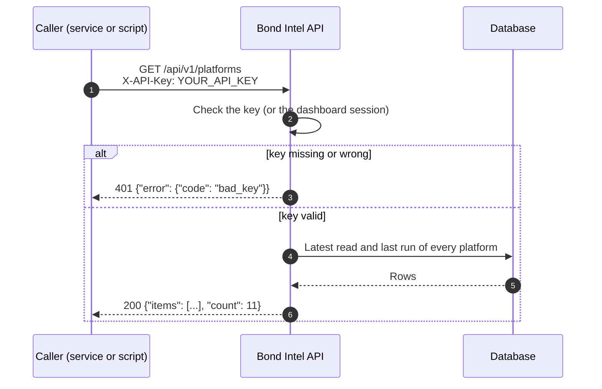
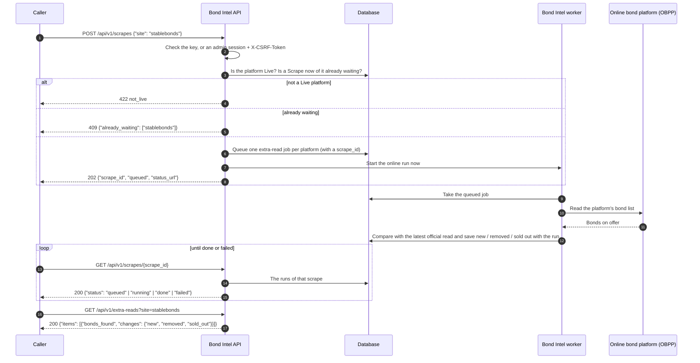
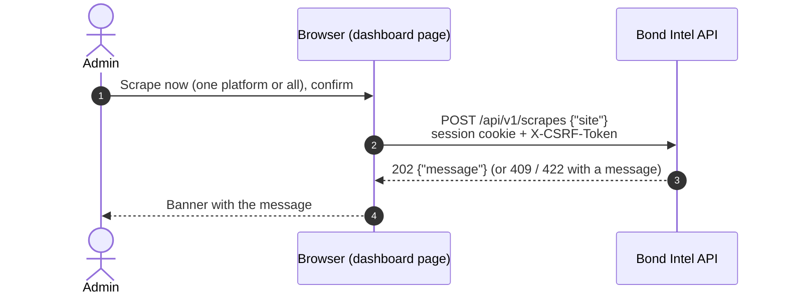

# Bond Intel API: sequence diagrams

How a call moves through the system. Endpoints and fields: [API reference](api.md). Components: [System design](system-design.md).

## 1. Reading data (any GET)

Every read is answered from the database. The dashboard keeps a read for a minute, so repeated calls are fast, and any change made from the dashboard clears it.

The other reads follow the same path: `/platforms/{key}` (benchmark for the period plus every platform's latest read), `/platforms/{key}/listings` (one day's read, paged), `/bonds/{isin}` (the bond master plus each platform's latest listing), `/categories` (latest reads plus the category list).

## 2. Scrape now (POST, then follow it)

A Scrape now is an extra read: saved with its run and compared with the latest official read, never written into the day's snapshot.

The online run usually starts within a few minutes. If it cannot be started at once, the queued job runs at the next scheduled online run or on the backup worker, whichever comes first.

## 3. The dashboard's own Scrape now button

The buttons on the Sources page and on a platform's profile call the same endpoint with the signed-in session. Without JavaScript, the form posts to the dashboard instead and the result is the same.

