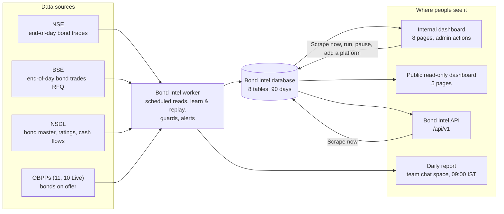
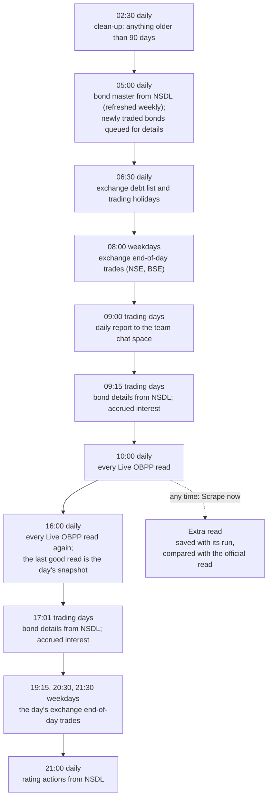

# Bond Intel: system design (high level)

Bond Intel follows India's bond market for Blostem in one place: what traded on the exchanges each day, what the online bond platforms (OBPPs) offer, at what yields, and how fast it sells. Data is fetched from **NSE, BSE, NSDL and the OBPPs by the Bond Intel worker**, kept in one database, and shown in a dashboard, a daily report and an API.

See also: [PRD](prd.md) · [User flows](user-flows.md) · [API](api.md) · [API sequence diagrams](api-sequence.md)

## Overview

## Components

| Component | What it does |
|---|---|
| **Bond Intel worker** | Runs every scheduled job (see [Data flow in a day](#data-flow-in-a-day)): exchange trades, the bond master and bond details, OBPP reads at 10:00 and 16:00 IST, the daily report at 09:00 on trading days, and clean-up. It runs online on a schedule; a backup worker takes over when the online run cannot. Only one worker runs at a time (a lease in the database), and a job missed while nothing was running catches up once |
| **Exchange loader** (part of the worker) | Fetches each trading day's bond trades from NSE and BSE (order book and BSE RFQ), combines them per bond and exchange, and keeps the day's highs, lows, values and yields as published |
| **Reference loader** (part of the worker) | Fetches the bond master from NSDL, then the details of each newly traded bond (issuer, category, sector, rating and agency, coupon, maturity, security, seniority, cash flows) and the day's rating actions |
| **OBPP reader** (part of the worker) | One reader for every platform, with no code per site. It learns a platform once from its address (where the bonds are, how to page, which field is which), saves that as a recipe and replays it on schedule. A read that looks broken (no bonds, under half the usual count, fields suddenly empty) is not saved: the last good data stays, an alert goes out, and after 3 failures in a row the platform pauses. A browser tab that crashes is tried again up to 5 times; a visit is cut off after 5 minutes and a run after 20 |
| **Database** | 8 tables: exchange trades, OBPP listings (one official read per platform per day), the bond master, tasks and schedules, the job queue and run history, alerts and audit trail, settings, migrations. History is kept 90 days |
| **Internal dashboard** | Eight pages for the team (Overview, Exchange, OBPP listings, Platforms, Category share, Sources, Daily report, Settings). Sign-in with a company account on an access list; admins manage sources, schedules, users and the report |
| **Public read-only dashboard** | The five reading pages (Overview, Exchange, OBPP listings, Platforms, Category share) for anyone with the link. It can read only, changes nothing and has no API or admin pages |
| **Bond Intel API** | JSON for other services: platforms, listings, bonds, categories, and Scrape now. On the internal dashboard only, with a shared key |
| **Daily report** | Each trading day at 09:00 IST: market totals, top traded bonds, OBPP fast sellers and yield moves, headed by 3–5 AI-written takeaways. Every number, date and ISIN in a takeaway must match the data, or the takeaway is dropped. Alerts go to the same chat space |

## Data flow in a day

All times IST, from the live schedule.

## Design choices

| Choice | Why |
|---|---|
| One reader for all OBPPs, learned from the address | A new platform needs no code: an admin confirms its link once and it is Live on the same schedule |
| Learn once, replay on schedule | Scheduled reads are quick and repeatable; a site that changes is learned again automatically |
| Guards before saving | A broken read never replaces good data |
| One official read per platform per day | Day-over-day changes (launches, sold out, units sold, yield moves) compare like with like; a Scrape now is kept apart as an extra read |
| Numbers computed from the data, never by the AI | The AI only words the takeaways; every figure it uses is checked against the data before sending |
| Read-only public copy without internals | The public dashboard shares the data, not how it is collected |
| Nothing stored in the browser | Every page is built on the server from the database; filters live in the address, so a view can be bookmarked or shared |
