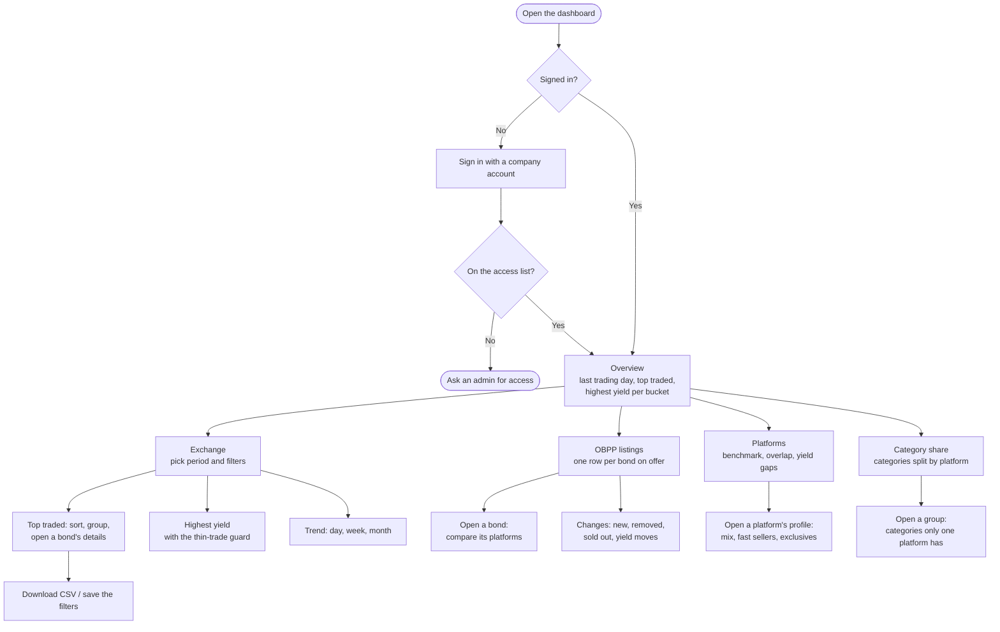
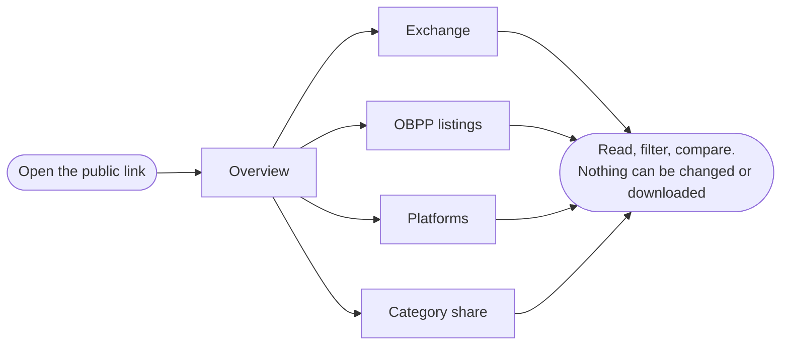
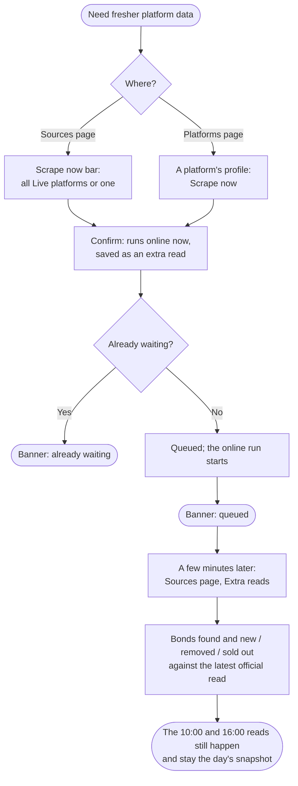
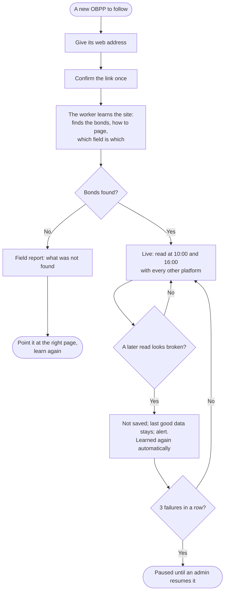
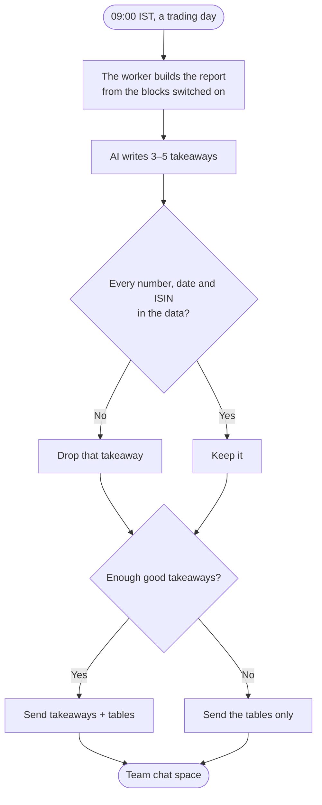
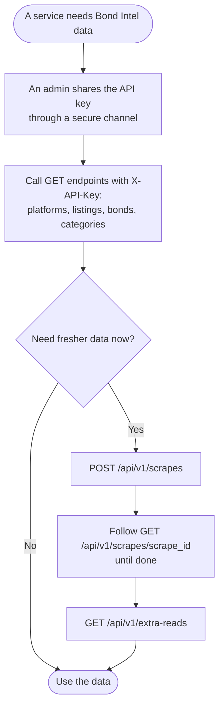

# Bond Intel: user flows

Who does what, step by step. Screens: [PRD](prd.md). Components: [System design](system-design.md).

## 1. Viewer: read the market and the platforms

## 2. Public reader: the read-only link

## 3. Admin: Scrape now

## 4. Admin: add a platform

## 5. Team: the daily report

## 6. Internal service: use the API

